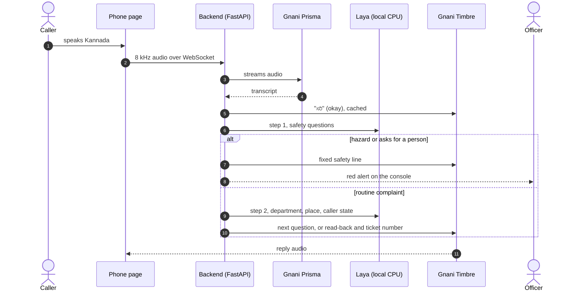
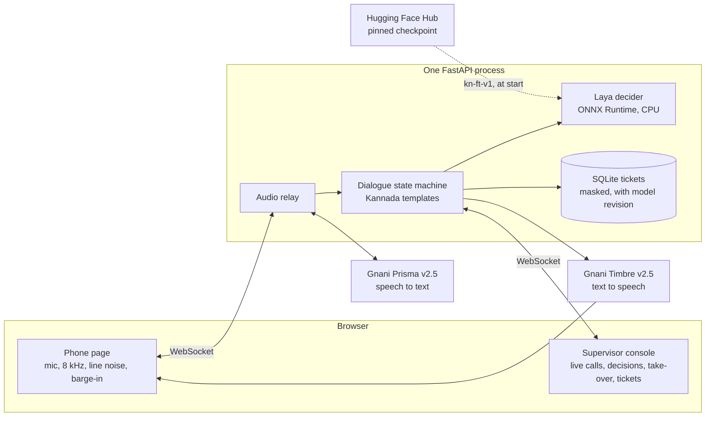
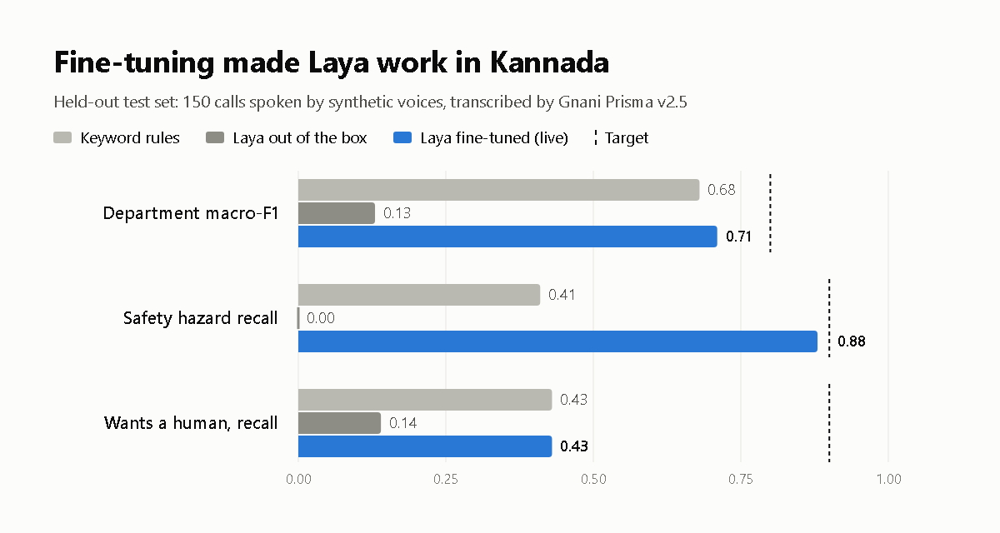
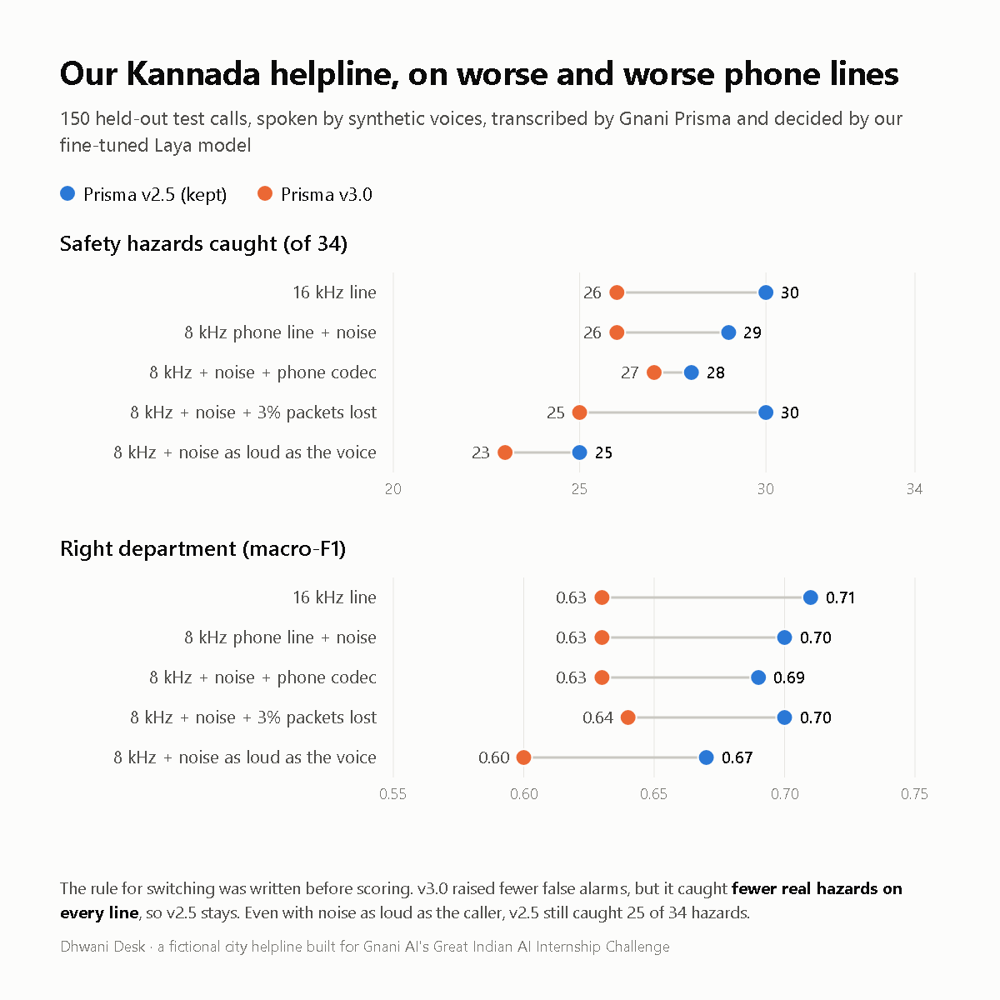

<div align="center">

# Dhwani Desk

**A Kannada voice helpline for civic complaints that hands danger to a person first.**

[](https://github.com/Pranav-0710/dhwani-desk/actions/workflows/ci.yml)
[](LICENSE)


[Demo video (LinkedIn)](https://lnkd.in/p/gNMNPkh4) · [Demo video (X)](https://x.com/jey_pranav53258/status/2116888213851963672) · [One-page pitch](docs/PITCH.md) · [Write-up](docs/WRITEUP.md) · [Design (PRD)](docs/PRD.md) · [Run it](#run-it)

</div>

A caller rings the city helpline and just talks, in Kannada, on an ordinary phone line. **Gnani Prisma** transcribes the call, a fine-tuned **Laya** model decides what the caller needs, and **Gnani Timbre** speaks the reply. Routine complaints end with a ticket number. A fallen live wire or a child near an open drain goes straight to an officer, before any routine question, with a ticket marked emergency. A supervisor console shows every live call with each decision's confidence, and an officer can take over and speak in the agent's voice.

Every decision runs locally on a laptop CPU. There is no LLM in the call: replies come from fixed Kannada templates, so the agent never invents an answer.

Built for Gnani AI's **Great Indian AI Internship Challenge**.

> [!NOTE]
> The city in the demo, *Nagara Seva, City Corporation of Hosapura*, is fictional, and all data is synthetic: no real callers, names, phone numbers or ID numbers.

## At a glance

| | |
| --- | --- |
| **Safety hazards caught** | **30 of 34** on held-out test calls (25 of 34 even with noise as loud as the caller) |
| **Routing** | Department macro-F1 **0.71**, up from **0.13** for Laya out of the box |
| **Phone-line cost** | Department macro-F1 drops by only **0.01** on an 8 kHz noisy line |
| **First response** | The agent says "ಸರಿ" ("okay") about **1.5 s** after the caller stops |
| **Cost per decision** | **₹0**: Laya runs on CPU, so only speech goes to the Gnani APIs |
| **Tests** | **635** backend and console tests run in CI on every pull request, plus 123 for the training code and 20 for the evaluation harness |

## Contents

- [The problem](#the-problem)
- [What a call looks like](#what-a-call-looks-like)
- [Architecture](#architecture)
- [How decisions are made](#how-decisions-are-made)
- [Results](#results)
- [Built to be trusted](#built-to-be-trusted)
- [Run it](#run-it)
- [Repository layout](#repository-layout)
- [Data and training](#data-and-training)
- [Limitations and next steps](#limitations-and-next-steps)
- [Team](#team)

## The problem

Civic helplines in Kannada-speaking cities are built around English menus, office hours and one operator at a time. Urgent calls (an open manhole, a live wire on a flooded road) wait behind routine ones, and complaints reach the wrong department.

Dhwani Desk lets a caller describe the problem in their own words, asks only for what is missing, and puts urgent calls in front of a person at once.

## What a call looks like

1. **The caller describes the problem.** "ಕಸದ ಗಾಡಿ ಒಂದು ವಾರದಿಂದ ಬಂದಿಲ್ಲ" (the garbage truck hasn't come for a week).
2. **The agent asks only for what is missing,** such as the ward or a landmark, then reads back the department and ward and gives a ticket number.
3. **Danger skips the queue.** If the caller describes a hazard or asks for a person, the agent says a fixed safety line and hands the call to an officer straight away.
4. **The officer can step in.** The console turns the call red. The officer takes over, types a reply that Timbre speaks in the agent's voice, and can hand the call back.
5. **The caller can interrupt** the agent at any time (barge-in), as on a real call.



## Architecture



| Part | Technology | Runs on |
| --- | --- | --- |
| Speech to text | Gnani **Prisma v2.5** realtime, `kn-IN`, 8 kHz telephony audio | Gnani API |
| Text to speech | Gnani **Timbre v2.5**, `kn-IN`, streamed | Gnani API |
| Decisions | **Laya** 0.4.6 multilingual decision engine, fine-tuned on synthetic Kannada complaints, exported to ONNX | Laptop CPU |
| Dialogue | Deterministic state machine with Kannada reply templates | Backend |
| Backend | Python 3.11, FastAPI, WebSockets, SQLite, `uv` | Docker |
| Console | React 19, TypeScript, Vite, served by nginx | Docker |
| Training data and fine-tuning | Qwen3-14B (4-bit) writes and checks the synthetic sentences; Laya's own fine-tuning code | Kaggle, 2×T4 |

Every external model sits behind a thin interface (`backend/gnani/`, `backend/decisions/`), so the call logic never talks to a vendor SDK directly.

## How decisions are made

On every caller turn, Laya answers ten questions about the whole call so far. Two are answered by code: the ward (matched against the city's ten wards and their landmarks) and whether the caller said a personal ID number. The rest come in two steps, so danger is acted on first:

| Step | Questions | Acts on |
| --- | --- | --- |
| **1. Safety** | safety hazard · urgency (routine to emergency) · wants a human · out of scope | Hazard over 0.6 or "emergency" → safety line and an officer. Wants a human over 0.7 → an officer |
| **2. The rest** | department (7) · a location was given · repeat complaint · caller's state | Department routed only at confidence ≥ 0.6. A distressed or abusive caller → an officer |

The seven departments are water, sewage and drainage, solid waste, roads, streetlights, stray animals, and other. If step 2 is slow, the agent says "one moment" so the line never goes quiet. The thresholds live in one file, [`backend/decisions/thresholds.py`](backend/decisions/thresholds.py), shared by the call, the console and the evaluation.

## Results



Held-out test set: 150 calls written separately from the training data and never seen by the generator or the training run. Spoken by four Timbre voices, transcribed by Prisma at 16 kHz. A department counts only when the agent would act on it (confidence ≥ 0.60). Full report: [`eval/reports/test-kn-ft-v1-timbre.md`](eval/reports/test-kn-ft-v1-timbre.md).

| Metric | Target | Keyword rules | Laya out of the box | **Laya fine-tuned** |
| --- | --- | --- | --- | --- |
| Department macro-F1 | ≥ 0.80 | 0.68 | 0.13 | **0.71** |
| Safety hazard recall | ≥ 0.90 | 0.41 | 0.00 | **0.88** (precision 0.58) |
| Wants a human, recall | ≥ 0.90 | 0.43 | 0.14 | **0.43** |
| Macro-F1 drop, 8 kHz + noise | reported | 0.01 | 0.00 | **0.01** |

**Read honestly:** fine-tuning made Laya usable for Kannada, but it misses all three targets. Safety recall is close, and the model leans towards caution: some ordinary drain and pothole complaints reach an officer, on an emergency ticket, instead of getting a routine one. We accept that over a missed emergency. "Wants a human" is the weakest result, because few training rows ask for a person.

### On worse and worse phone lines



We played the test audio through harsher 8 kHz lines: a G.711 phone codec, 3% of packets lost, and noise as loud as the voice. Codec and packet loss cost almost nothing. Noise as loud as the voice is where it starts to break, and even there the agent caught 25 of 34 hazards.

### Every model change has to pass a rule written before scoring

The rule, in [`eval/compare.py`](eval/compare.py): **no fall in safety recall, and a real gain somewhere.** It was fixed before any test result for the challenger existed, and the test set is never tuned against.

| Challenger | What it improved | Why it was rejected |
| --- | --- | --- |
| Second fine-tune `kn-ft-v2` | Wants a human 3 → **5 of 7**, urgency accuracy 0.49 → 0.57 | Caught 28 of 34 hazards against 30 ([report](eval/reports/switch-kn-ft-v2.md)) |
| Third fine-tune `kn-ft-v3`, v1's data plus v2's officer requests | Wants a human 3 → **4 of 7**, hazard precision 0.58 → 0.71 | Caught 27 of 34 hazards against 30 ([report](eval/reports/switch-kn-ft-v3.md)) |
| Fixed safety phrases in code | Strong on generated rows | Caught no extra hazards on the test set ([note](docs/decisions/safety-phrases.md)) |
| Gnani Prisma v3.0 | Fewer false alarms, 4 of 7 officer requests | Fewer real hazards caught on every line ([report](eval/reports/switch-prisma-v3.0.md)) |

So the live system stays on `kn-ft-v1` and Prisma v2.5. Prisma v3.0 doesn't suit *our* model, which was trained on v2.5-style transcripts. That says nothing about how well v3.0 transcribes Kannada.

### Latency

The agent says "ಸರಿ" ("okay") about 1.5 s after the caller's last word, from a cached line. The full answer follows 2.8 s after the caller stops on a quiet run, and up to 6 s on a busy laptop: Prisma's transcript (~0.75 s), a 0.6 s pause to let the caller finish, Laya (1–4 s on CPU) and Timbre (~0.3 s). Details: [`docs/decisions/laya-latency.md`](docs/decisions/laya-latency.md).

## Built to be trusted

**Safety first**
- The safety questions run before anything else, and a hazard ends the routine flow at once.
- A hazard files a ticket marked emergency the moment the call is handed off, so it is kept even if the caller hangs up straight after the safety line.
- If a decision or a ticket write fails, the call goes to an officer instead of going silent.
- Replies are fixed templates: nothing the agent says is generated.

**Privacy**
- Only audio goes to Prisma and only reply text goes to Timbre; every decision is made on the machine.
- Personal ID numbers are masked before storage, including numbers spoken as words ("ಡಬಲ್ ಒಂಬತ್ತು…", "double nine…").
- Transcripts are deleted after 7 days, and the caller's location words are blanked after 30.

**Audit**
- Every decision the agent acts on is stored with each answer's probability and the exact checkpoint revision, whether the call ends in a ticket, a hand-off or a redirect.
- The checkpoint is pinned to a Hugging Face tag (`kn-ft-v1`) and is never "latest".

**Safe to demo in public** ([security model](docs/decisions/security-model.md))
- Calls and the console only open from allowed pages.
- The console and tickets API need a token.
- There are per-caller limits, two lines at a time, a daily credit ceiling, and silent sockets are hung up.

**Resilient**
- If Prisma drops mid-call, the call reconnects without greeting again.
- Audio that piled up during the gap is trimmed rather than overflowing.

## Run it

**Needs:** Docker Compose 2.24+, a Gnani API key, and a Hugging Face read token for the checkpoint.

```bash
git clone https://github.com/Pranav-0710/dhwani-desk.git
cd dhwani-desk
cp .env.example .env   # set GNANI_API_KEY, HF_TOKEN and CONSOLE_TOKEN
docker compose up --build
```

| Open | For |
| --- | --- |
| http://localhost:8080 | The phone page: press **Call** and speak Kannada (a headset stops the agent hearing itself) |
| http://localhost:8080/supervisor | The supervisor console, signed in with `CONSOLE_TOKEN` |

The first start downloads the checkpoint (about 1.3 GB) and loads it in about 15 s. To run without it, set `DECIDER=keyword` and `LAYA=0` in `.env`.

Sharing a demo over a Cloudflare tunnel, operating the console and troubleshooting are covered in the [runbook](docs/runbook.md).

<details>
<summary><b>Development and checks</b> (the same as CI)</summary>

```bash
# Backend
cd backend
uv sync
uv run uvicorn app:app --reload
uv run ruff check . && uv run ruff format --check . && uv run pytest -q

# Console
cd console
npm ci
npm run dev
npm run lint && npm run typecheck && npm test && npm run build
```

CI also scans for secrets and rejects notebooks committed with outputs.

</details>

## Repository layout

```
dhwani-desk/
├── backend/      FastAPI: audio relay, Gnani clients, dialogue, Laya serving, tickets
│   ├── gnani/        Prisma and Timbre clients (thin interfaces)
│   ├── decisions/    Laya serving, ward and number detectors, thresholds
│   ├── dialogue/     state machine and Kannada reply templates
│   ├── audio/        speaker, barge-in, outbox
│   └── tickets/      SQLite store, masking, retention
├── console/      React + TypeScript: phone page and supervisor console
├── data/         decision schema, wards, seed and held-out test sets (synthetic)
├── training/     Kaggle notebooks: benchmark, data generation, fine-tuning
├── eval/         evaluation harness, phone-line simulation, switch rule, reports
└── docs/         PRD, write-up, runbook, design decisions, contributions
```

## Data and training

| Set | Size | How it was made |
| --- | --- | --- |
| Seed | 50 | Hand-written and hand-labelled caller turns, for the first benchmark |
| Training | 2,874 | Written by Qwen3-14B from sampled scenarios. A row is kept only if it passes text checks and the model, shown only the sentence, picks the scenario it was written for (931 attempts failed and were rewritten) |
| Held-out test | 150 | Written separately and checked by hand; spoken by four Timbre voices at three speeds |

Generation and fine-tuning ran on Kaggle (2×T4), never on a laptop, and the notebooks are in [`training/`](training/). The checkpoint and datasets live in private Hugging Face repos, and tokens come from Kaggle secrets.

A 10% hand check of the training set found the labels right in 97% of rows, but only 28% of the sentences read as natural Kannada. The model learns from noisy text, and the held-out set measures what that costs.

## Limitations and next steps

- **Keep the officer-request gain without losing hazards.** Two fine-tunes raised officer requests (to 5 and 4 of 7), and both caught fewer hazards, so neither went live. Adding officer-request rows alone (`kn-ft-v3`) was not enough.
- **A faster safety step.** We tested int8 on the fine-tuned model: about 6× faster, but it dropped 23 of the live model's safety hand-offs on 350 non-test sentences, so we kept fp32. int8 on only part of the encoder failed the same check ([details](docs/decisions/laya-latency.md#what-was-tried)). Next is quantization-aware fine-tuning or a smaller model.
- **Labels checked by a non-native reader.** The labels and the test set were checked against written rules, not by a native Kannada speaker.

## Team

| | Role |
| --- | --- |
| **Jey Pranav** ([@Pranav-0710](https://github.com/Pranav-0710)) | Voice pipeline, Laya serving, data, fine-tuning, evaluation, console, delivery |
| **Lakshmi Narasimman** ([@lakshmi-narasimma](https://github.com/lakshmi-narasimma)) | Generator changes for the second fine-tune, review and testing |

Every change went through an issue, its own branch and a reviewed pull request with CI. [`docs/CONTRIBUTIONS.md`](docs/CONTRIBUTIONS.md) logs who did what, PR by PR. Working rules: [`STRUCTURE.md`](STRUCTURE.md), [`AGENTS.md`](AGENTS.md).

## Acknowledgements

- [Gnani AI](https://gnani.ai) for Prisma and Timbre, and for running the challenge.
- [Laya](https://huggingface.co/convaiinnovations/laya-multilingual), the open decision engine we fine-tuned.
- Kaggle for the GPUs.

## License

[Apache 2.0](LICENSE)
