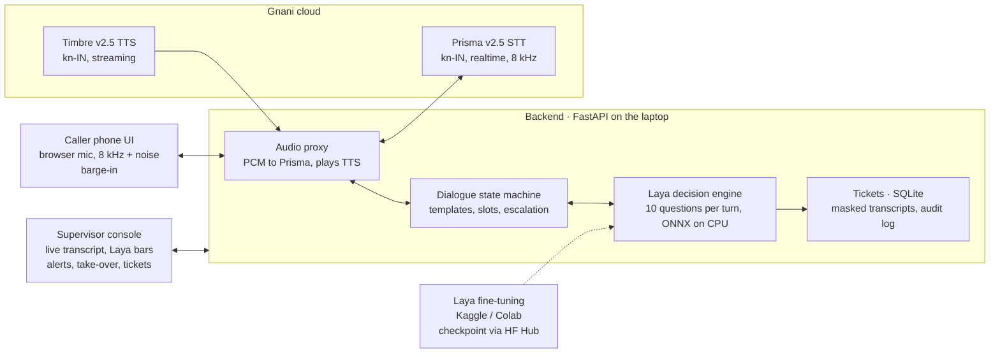
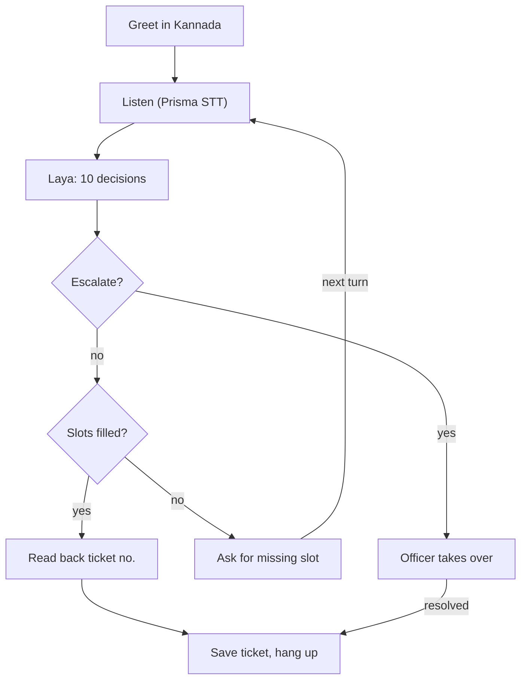
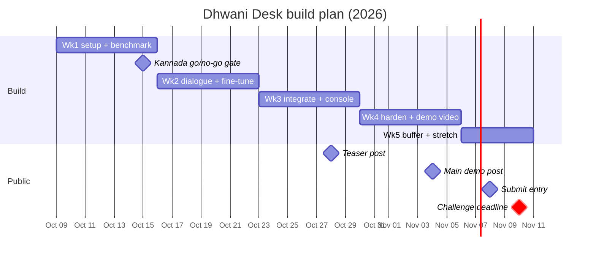

# Dhwani Desk — PRD & Build Plan

Dhwani Desk is a Kannada-first voice helpline for civic complaints: Gnani Prisma hears the caller, Laya makes every routing and escalation decision locally for ₹0, and Gnani Timbre answers — submitted to the Great Indian AI Internship Challenge by **Nov 10, 2026**.

Team: Jey Pranav (A — voice & serving), Lakshmi Narasimman (B — data, ML & product).

## Problem and users

Citizens in Kannada-speaking cities report civic problems by phone, but helplines are built for English menus, office hours and one human operator at a time. Urgent calls (an open manhole, a live wire on a flooded road) queue behind routine ones, and complaints get routed to the wrong department.

| User | What they need | What Dhwani Desk gives them |
| --- | --- | --- |
| Caller (citizen, often Tier 2/3, Kannada or Kannada-English mixed, on a noisy phone line) | Speak naturally, get a ticket number, know someone will act | A voice agent that understands Kannada at 8 kHz, asks only for what is missing, reads back a ticket number |
| Supervisor (helpline operator) | See what matters now, step in when the bot should not handle it | A live console with every decision and its confidence, alerts and one-click take-over |
| Department field team | A complaint that is theirs, with a location they can find | Tickets routed by department and ward, with the landmark verbatim |

The city in the demo is fictional ("Nagara Seva, City Corporation of Hosapura"); no real authority is named or imitated.

## Scope

The MVP is a live Kannada voice agent plus a supervisor console; post-call batch analytics and LiveKit telephony are stretch goals.

**MVP (must ship by Nov 5)**

- Browser "phone" that streams mic audio to the backend, downsampled to 8 kHz, with an optional noise toggle
- Prisma v2.5 realtime STT (`kn-IN`) via a backend WebSocket proxy, with a boost list of ward and landmark words
- Laya decides department, ward, urgency, hazards, escalation and more on every caller turn (one batched call)
- Template-driven dialogue state machine: issue → location → confirm → ticket number; no LLM in the call path
- Timbre v2.5 TTS (`kn-IN`) speaks replies; caller can barge in and interrupt
- Escalation to a human supervisor, who can take over by typing replies that Timbre speaks
- Tickets stored in SQLite with department, ward, urgency and the verbatim landmark
- Supervisor console: live calls, streaming transcript, Laya decision bars, alerts, tickets table
- Fine-tuned Laya checkpoint and an evaluation report on a held-out human-written test set

**Stretch (only after MVP is solid)**

- Laya end-of-turn detection on top of Prisma's VAD
- Self-hosted LiveKit room using Gnani's LiveKit plugin
- Analytics page: complaints by ward and department, escalation rate
- Batch page: upload recorded synthetic calls → Prisma batch STT with diarization → same Laya schema for post-call QA
- Optional end-of-call summary from a small open model

**Non-goals**

- Real phone numbers, real citizen data or a real municipal brand
- Free-form chit-chat or open-domain Q&A
- Evon v3.3 (30B) in the product: our hardware cannot run it
- More than one regional language before Nov 10

## Architecture

One FastAPI process on the laptop sits between the caller and Gnani: it proxies audio to Prisma, asks Laya what the caller means, picks a template reply and streams it back through Timbre.

Solid arrows are the live call path; the dashed arrow is offline training. Only audio and reply text leave the laptop. The browser cannot send Prisma's auth headers, so all Gnani traffic goes through the backend proxy; the console subscribes to the same backend over a WebSocket.

## Call flow

The agent is a deterministic state machine: Laya answers its questions every turn, and the machine either escalates, asks for what is missing, or closes the ticket.

Slots are department, ward and landmark. Escalation fires on any rule in the next section, and the caller can interrupt any spoken reply (barge-in).

## Laya decision schema

Laya answers 10 questions about the conversation so far in one batched call per caller turn; the state machine and the console read only these numbers. State = the running Kannada transcript (native script) plus the slots already filled.

| ID | Type | Question / options | Used for |
| --- | --- | --- | --- |
| `department` | choice | water · sewage-drainage · solid-waste · roads · streetlights · stray-animals · other | Routing the ticket |
| `ward` | choice | ~10 fictional wards of Hosapura + `unknown` | Which field team gets it |
| `urgency` | score | routine → soon → urgent → emergency | Queue order, escalation |
| `safety_hazard` | noul | Is there immediate risk to life or health (live wire, open manhole, flooding)? | Immediate escalation |
| `has_location` | noul | Did the caller give a usable location or landmark? | Whether to ask for location |
| `repeat_complaint` | noul | Does the caller say this was reported before? | Priority bump, console flag |
| `wants_human` | noul | Does the caller ask for a human officer? | Escalation |
| `caller_state` | choice | calm · frustrated · distressed · abusive | Tone of reply, escalation |
| `out_of_scope` | noul | Is this not a civic complaint (police, medical, private dispute)? | Polite redirect script |
| `contains_personal_id` | noul | Does the utterance contain an ID, account or phone number? | Masking before storage |

- Questions are written in English; Laya's multilingual checkpoint reads the Kannada state directly. Week 1 tests whether Kannada question text scores better.
- Every answer is stored with its probability and the model version, so any decision can be audited later.
- New questions are added only with labelled test data for them; latency budget on the laptop CPU, for a caller's first turn, is ≤ 0.5 s p95 for the safety questions, asked first, and ≤ 2.5 s p95 for the whole decision, with a cached "one moment" line covering the wait; later turns are slower because Laya rereads the whole call ([measured](decisions/laya-latency.md)).

## Escalation and safety rules

The bot hands the call to a human whenever a wrong automatic decision could hurt someone; thresholds start here and are tuned on the test set.

| Trigger | Threshold (v1) | What happens |
| --- | --- | --- |
| Safety hazard | `safety_hazard` > 0.6 | Agent speaks a safety line, red alert on console, ticket marked emergency |
| Emergency urgency | `urgency` = emergency | Same as safety hazard |
| Caller asks for a person | `wants_human` > 0.7 | "Connecting you to an officer", console take-over prompt |
| Distressed or abusive caller | `caller_state` ∈ {distressed, abusive} | Calm hand-off script, console alert |
| Bot cannot route | `department` confidence < 0.6 after 2 turns | Hand-off with transcript so far |
| Not a civic complaint | `out_of_scope` > 0.7 | Redirect script (e.g. police 112); no ticket |

Take-over: the supervisor types a reply in the console and Timbre speaks it in the same voice, so the call does not break. The supervisor can hand the call back to the bot. Laya's `min_confidence` gate is used for every answer: a low-confidence answer is never acted on silently — it either triggers a clarifying question or an escalation.

## Data, fine-tuning and evaluation

Laya scores 0.45 zero-shot on non-English intent benchmarks, so we fine-tune it on synthetic Kannada civic complaints and prove the gain on human-written, spoken test data.

| Set | Size | How it is made | Used for |
| --- | --- | --- | --- |
| Seed | ~50 utterances | Hand-written by both of us, Kannada + Kannada-English mix | Week-1 zero-shot benchmark |
| Train | ~2,000–3,000 | Generated with Qwen2.5-7B on a free Kaggle or Colab GPU from templates per department × ward × urgency, 10% hand-checked | Fine-tuning |
| Test (text) | ~150 | Hand-written, never seen by the generator or the training run | Accuracy |
| Test (spoken) | same ~150 | Read aloud by us, recorded at 16 kHz, transcribed by Prisma at 16 kHz and at 8 kHz + noise | Real-world accuracy incl. STT errors |

**Week-1 gate: can Laya read Kannada?** Compare on the seed set:

1. Laya multilingual, zero-shot, Kannada state
2. Laya multilingual, zero-shot, Kannada state + Kannada question text
3. IndicTrans2 (Kannada → English) + Laya English checkpoint
4. Keyword rules baseline

Pick the best for the build; keep the others as fallbacks. Fine-tuning runs on Kaggle (2×T4) or Google Colab, starting from the notebook that ships with Laya; nothing trains on the laptop. Datasets and checkpoints go to private Hugging Face Hub repos, and the backend pulls a pinned checkpoint version.

**Success metrics (measured on the spoken test set)**

| Metric | Target |
| --- | --- |
| `department` macro-F1 after fine-tuning | ≥ 0.80, reported next to the zero-shot baseline |
| `safety_hazard` and `wants_human` recall | ≥ 0.90 (missing an emergency is worse than a false alarm) |
| Laya latency, laptop CPU, caller's first turn: safety questions / whole decision | ≤ 0.5 s / ≤ 2.5 s p95 |
| End of caller speech → first agent audio | ≤ 1.5 s |
| Accuracy drop, 8 kHz + noise vs clean | Reported honestly, whatever it is |

The eval harness is a script (`eval/run.py`) that prints this table, so every number in the demo and the write-up can be reproduced.

## Tech stack

Everything except Gnani's speech APIs is open source and runs on one laptop (Core Ultra 7 155H, 16 GB RAM, no CUDA); total cost is ₹0 beyond the 5,000 challenge credits.

| Layer | Choice | Why |
| --- | --- | --- |
| Speech-to-text | Gnani Prisma v2.5 realtime (`wss://api.vachana.ai/stt/v3/stream`, `kn-IN`, 8 kHz) | Required; trained on telephony audio |
| Text-to-speech | Gnani Timbre v2.5 (`kn-IN`), streaming | Required; Indian names and numerals |
| Decisions | Laya multilingual (`convaiinnovations/laya`), ONNX on CPU | Apache 2.0, runs on CPU (~0.4 s for the safety questions on the laptop), calibrated |
| Backend | Python 3.11, FastAPI, WebSockets, asyncio | One process for audio proxy, state machine and Laya |
| Storage | SQLite (SQLModel) | Zero setup, enough for a demo |
| Console + phone UI | React + Vite, plain WebSocket | Fast to build, easy to film |
| Fine-tuning | Kaggle (2×T4) and Google Colab notebooks; checkpoints on private HF Hub | Free GPUs; the laptop only runs inference |
| Data generation | Qwen2.5-7B on Kaggle / Colab GPU; datasets on private HF Hub | Free, fast, same data for both of us |
| Packaging | Docker Compose, `.env` for keys | Reproducible for judges |
| Demo hosting | Laptop + Cloudflare quick tunnel | Free public URL during demos |

Repo layout and the development workflow live in [`STRUCTURE.md`](../STRUCTURE.md).

## Privacy and compliance

The challenge allows synthetic data only, and we design as if real citizen data were at stake (DPDP-style).

- **Synthetic only:** no real phone numbers, Aadhaar, PAN or recorded calls. The demo caller picks a synthetic profile; test audio is our own voices reading scripts.
- **Decisions stay local:** Laya runs on our machine; only audio goes to Gnani for STT and only reply text goes to Gnani for TTS.
- **Masking before storage:** if `contains_personal_id` > 0.5, or any run of 10+ digits appears, the digits are masked in the stored transcript.
- **Retention:** transcripts auto-delete after a configurable number of days (shown in the console); tickets keep only the fields a field team needs.
- **Secrets:** API keys live in `.env`, never in the repo; `.env.example` documents them.
- **Audit:** every Laya answer is stored with its probability and model version.

## Team split

Each person owns a full vertical slice they can defend alone in their interview; both must be able to explain the Laya schema.

| Area | Jey Pranav (A) — voice & serving | Lakshmi Narasimman (B) — data, ML & product |
| --- | --- | --- |
| Gnani integration | Prisma WebSocket proxy, Timbre streaming, voice selection | Prisma batch STT for the spoken test set |
| Core logic | Dialogue state machine, barge-in, escalation, ticket creation | Laya schema wording, thresholds tuned from eval |
| Laya | ONNX serving on CPU, latency tuning | Benchmark, synthetic data, fine-tuning on Kaggle / Colab, eval harness |
| UI | Phone UI (mic, 8 kHz/noise toggle) | Supervisor console, tickets table, analytics |
| Delivery | Docker Compose, Cloudflare tunnel | Demo video, LinkedIn/X posts, write-up |
| Shared | Review of each other's PRs, `docs/CONTRIBUTIONS.md` kept current | Same |

## Milestones

Five weeks from Oct 9 to Nov 10; nothing is built on Laya until the week-1 Kannada test passes.

1. **Week 1** — A: repo skeleton, Prisma proxy, Timbre voice pick, echo bot. B: 50-utterance seed set, Laya zero-shot + IndicTrans2 benchmark, data generator.
2. **Week 2** — A: dialogue state machine, barge-in, 8 kHz/noise path. B: train set (~2–3k) + test set (~150) recorded through Prisma, fine-tune on Kaggle / Colab.
3. **Week 3** — A: Laya (ONNX) in the call loop, escalation, tickets. B: supervisor console MVP, eval harness, teaser post.
4. **Week 4** — A: end-to-end hardening, latency tuning, Docker Compose. B: 60 s demo video, main post.
5. **Week 5** — A: buffer, stretch goals (LiveKit, batch analytics). B: write-up, CONTRIBUTIONS.md, submission.

## Demo, posting and submission

Shortlisting depends on verified engagement, so the main demo post goes live about a week before the deadline and the submission goes in two days early.

**60-second demo video script**

1. 0–8 s — Hook: a caller speaks Kannada over a crackly line: "there's an open drain near the school".
2. 8–25 s — Agent asks for the landmark, reads back ward and ticket number in Kannada; console shows Laya's bars filling in real time.
3. 25–40 s — Second call: live wire after rain → safety line spoken, red alert, supervisor takes over by typing.
4. 40–52 s — One slide: zero-shot vs fine-tuned accuracy, 8 kHz + noise result, "no LLM in the call path, ₹0 per decision".
5. 52–60 s — Stack credits: Gnani Prisma + Timbre, Laya, open-source repo link.

**Posting and submission**

- Teaser post (build-in-public, the benchmark result or a 15 s clip): Oct 28, 2026
- Main 60 s demo post on LinkedIn and X, tagging Gnani AI with #GnaniAI #GreatIndianAIInternshipChallenge: Nov 4, 2026
- Final submission (video link, write-up, models used, post links, each member's contributions): Nov 8, 2026
- Engagement must be organic: no paid promotion, bots or engagement pods.

## Risks and fallbacks

The biggest risk is Laya's Kannada accuracy, which is why it is tested in week 1 before anything is built on it.

| Risk | Likelihood | Fallback |
| --- | --- | --- |
| Laya reads Kannada poorly even after fine-tuning | Medium | IndicTrans2 → English Laya; keyword rules for the weakest questions |
| Prisma `kn-IN` mishears code-mixed English words | Medium | Boost list for ward and landmark words; measure and report the error rate |
| 5,000 credits run out | Unknown until we see pricing | Cache TTS for fixed template lines; record the test set once and reuse transcripts |
| Laya too slow on CPU | Low | ONNX backend, `LAYA_THREADS` tuning, fewer questions per turn |
| Timbre Kannada voice sounds wrong on ward names | Medium | Try several of the 42 voices; respell names in templates |
| Browser cannot send auth headers to Prisma | Certain | Backend proxy (already in the design) |
| Live demo fails on stage | Medium | Pre-recorded fallback video |
| One teammate drops out | Low | Each slice is documented; scope cuts to MVP only |

## Open questions

- [ ] Both register for the challenge and sign in at app.gnani.ai/voice
- [ ] Find out what 5,000 credits buy (per audio minute for STT, per character for TTS)
- [ ] Confirm Prisma `kn-IN` handles Kannada-English mixed speech, or only `en-IN` mixes with Hindi
- [ ] Pick the Timbre Kannada voice by ear (several candidates from the 42)
- [ ] Write the 50-utterance seed set and run the week-1 Laya benchmark
- [ ] Name the ~10 fictional wards of Hosapura and their landmarks

## Sources

- [Great Indian AI Internship Challenge](https://www.gnani.ai/internship)
- [Gnani Speech APIs docs](https://docs.gnani.ai)
- [Prisma realtime STT (WebSocket)](https://docs.gnani.ai/api/STT/stt-websocket)
- [Timbre available voices](https://docs.gnani.ai/api/TTS/available-voices)
- [Gnani call-analytics recipe](https://docs.gnani.ai/api/use-cases/call-analytics)
- [Laya on GitHub](https://github.com/NandhaKishorM/laya)
- [Laya decision engine write-up](https://elsolitario.org/en/2026/09/19/laya-convai-decision-engine-33ms/)
